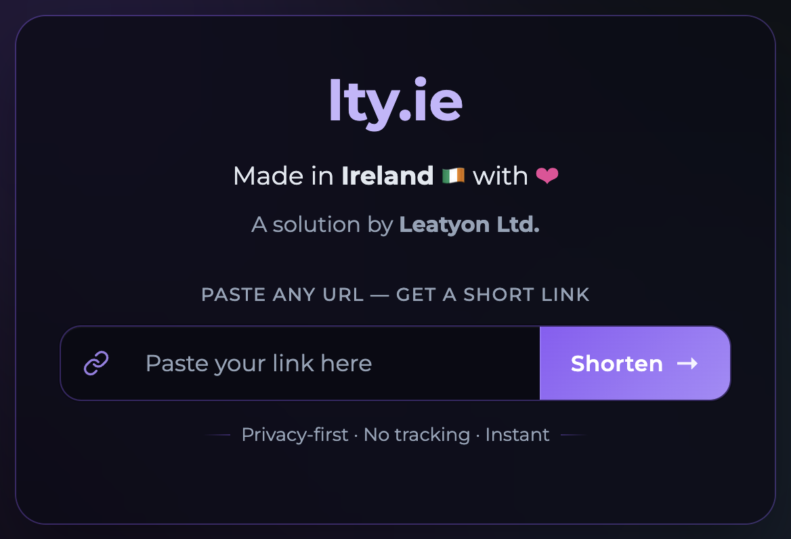

# lty.ie

Privacy-first URL shortener used in production at [lty.ie](https://lty.ie). Paste a long address, receive a six-character short link, and send visitors through a short safe-redirect screen.

The service is a Flask application with CSRF protection, SQLite storage, and a rate limit on how many links a single address can create per minute. The public homepage also acts as a branded redirect to [leatyon.org](https://leatyon.org).

<p align="center">
  <a href="docs/create.png">
    
  </a>
</p>

<p align="center"><em>Click the image to zoom.</em></p>

## Features

- Short links with unique 6-character tags
- CSRF-protected create form
- Per-IP creation quota (5 requests / 60 seconds)
- Loading page before the destination opens
- Optional TLS when certificates are present
- Docker image for a self-hosted deploy

## Requirements

- Python 3.11+
- The packages in `requirements.txt`
- Optional: TLS certificates in `ssl/origin.key` and `ssl/origin.pem` for HTTPS

## How to use

### Local server

```bash
python3 -m venv .venv
source .venv/bin/activate
pip install -r requirements.txt

export HOST=127.0.0.1
export PORT=8080
export FLASK_SECRET_KEY="replace-with-a-long-random-string"
python3 __main__.py
```

Open [http://127.0.0.1:8080/create](http://127.0.0.1:8080/create), paste a URL, and choose **Shorten**. The JSON API behind the form is `POST /add_redirect` with a `reference` field.

Visiting `/<tag>` shows the loading screen and then sends the browser to the saved destination.

### Docker

Place certificates in `ssl/` if you want HTTPS, then:

```bash
docker build -t lty-ie .
docker run --rm -p 8080:8080 \
  -e HOST=0.0.0.0 \
  -e PORT=8080 \
  -e FLASK_SECRET_KEY="replace-with-a-long-random-string" \
  lty-ie
```

### Environment

| Variable | Purpose | Default |
| --- | --- | --- |
| `HOST` | Bind address | `::` |
| `PORT` | Bind port | `443` |
| `FLASK_SECRET_KEY` | Flask/CSRF secret | generated at startup |
| `SSL_KEY_PATH` | TLS private key | `./ssl/origin.key` |
| `SSL_CERT_PATH` | TLS certificate | `./ssl/origin.pem` |

If the certificate files are missing, the process listens over plain HTTP so local development does not need production keys.

## Project layout

```
__main__.py            # process entry
web.py                 # Flask app, database, server
models/routes/         # HTTP routes
models/database/       # Redirect model
templates/             # Jinja pages
static/                # CSS and favicon
```

## License

GNU General Public License v3.0. See [LICENSE](LICENSE).
